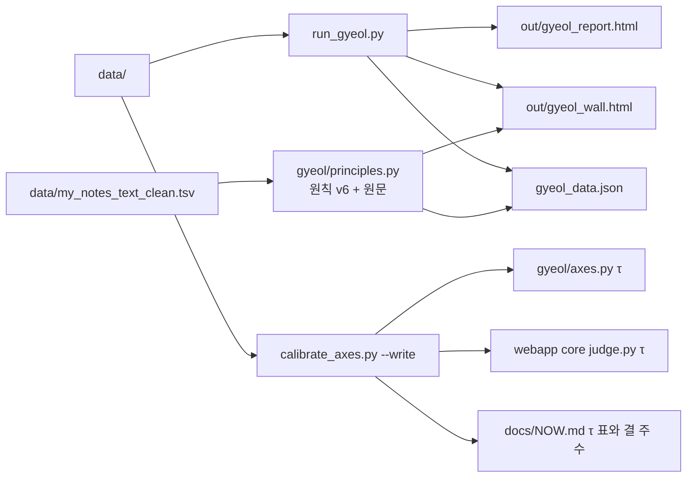

# pipeline

`gyeol_kit/` 은 드라이브 `gyeol_kit/code/` 의 9/12 판에서 출발했습니다(`_backup*`, `out/`, `__pycache__/` 제외). 4축 판정의 정본은 `gyeol/axes.py` 입니다.

## 명령 두 개면 됩니다

```bash
cd pipeline/gyeol_kit
python3 run_gyeol.py --name "카톡 표시 이름"                    # 리포트, 지층 벽, 앱 데이터를 한 번에
python3 calibrate_axes.py --name "카톡 표시 이름" --write        # lang·talk τ 와 결 주 수를 실데이터로 다시 재서 반영
```



## run_gyeol.py 한 번이 세 단계를 대신합니다

`run_gyeol.py` 는 `out/gyeol_report.html`, `out/gyeol_wall.html`, 키트 최상단 `gyeol_data.json` 을 한꺼번에 만듭니다. 벽과 앱 데이터에는 원칙 v6 이 이미 들어가 있습니다. 최근 8주를 뺀 봉인은 걷고, 두드러진 주에는 회복 서사를 붙이지 않고, 그 주에 쓴 글(`data/my_notes_text_clean.tsv`)을 붙입니다. 리포트만 필요하면 `--report-only` 를 씁니다.

전에는 `make_wall.py`, `add_relics.py`, `apply_principles.py` 를 차례로 돌려야 했고, 순서를 틀리면 산출물이 달라졌습니다. 이제 이 처리는 `gyeol/principles.py` 에 있습니다. 그래서 `add_relics.py` 와 `apply_principles.py` 는 이미 만든 파일에 다시 입힐 때만 쓰는 하위호환 래퍼로 남았습니다.

## calibrate_axes.py --write 는 못 잰 축을 건드리지 않습니다

`--write` 를 붙이면 `out/calibration_report.md` 맨 앞 「τ 다시 재기」 절에 새 τ, 광물이 생기는 주 수, 결 주 수를 적습니다. 그리고 `gyeol/axes.py`, `webapp/core/mined_core/judge.py`, `docs/NOW.md` 의 값을 고칩니다. 기록이 모자라 재지 못한 축(예: 카톡 본인 이름을 못 찾은 소통)은 임시값과 ⚠ 표시를 그대로 둡니다. `--write` 를 빼면 파일은 바꾸지 않고 붙여 넣을 값만 출력합니다. move·rest 는 9/11 확정값이라 `--axes move,rest,lang,talk` 로 명시할 때만 다시 잽니다.

## 파일

```
gyeol_kit/
  run_gyeol.py          리포트 + 지층 벽 + 앱 데이터 (원칙 v6, 원문까지)
  calibrate_axes.py     τ 캘리브레이션, --write 로 lang·talk τ 반영
  make_wall.py          지층 벽만 (run_gyeol.py 가 build_wall 을 부름)
  export_app_data.py    앱용 JSON 만 (run_gyeol.py 가 build_app_data 를 부름)
  add_relics.py         하위호환 래퍼 → gyeol/principles.py
  apply_principles.py   하위호환 래퍼 → gyeol/principles.py
  build_axes_json.py    4축 판정 JSON (axes.py 사용)
  compare_specs.py      스펙 비교
  check_rest.py         쉼 축 점검
  sanitize_notes.py     메모 원문 위생 필터 (원문을 붙이려면 먼저 돌림)
  tests/                실데이터 없이 도는 시험: python3 -m pytest -q pipeline/gyeol_kit/tests
  gyeol/
    axes.py             4축, τ, 광물, 결의 정본
    principles.py       원칙 v6, 원문 붙이기
    retune.py           τ 다시 재기와 파일 반영
    channels.py         채널 정의
    detect.py           파일 내용으로 채널 판별
    parse_*.py          건강, Takeout, 카톡, AI, 메모, 사진 파서
    rolling_baseline.py 이동 기준선
    analyzer_v3.py      백분위 판정
    judge.py            근거 부족, 단일 출처 억제, 문장 생성
    crisis_filter.py    인출 필터
    report.py           커버리지 리포트
```

`data/` 는 `.gitignore`가 차단합니다. **절대 커밋하지 마세요.**

NOW(10/2) 열린 일 가운데 파이프라인 몫으로 남은 것은 두 가지입니다. `pickGem` 을 축, 방향, 교차검증 기준으로 바꾸는 일(웹앱에는 반영됨)과 쉼 축의 밤 무기록 대체 지표(웹앱 `webapp/web/src/import/quiet.ts` 에 구현돼 있음)입니다.
